## Hi there 👋

I just graduated with a PhD from Ghent University & IMEC on EMF dosimetry for 5G wireless networks, building tools to compute how much power the human body absorbs from wireless signals.

🎓 Take a look at the book, slides, recording and pics [here](https://phd.rwydaeghe.be/)!

🌐 I have a small [personal website](https://www.robinwydaeghe.com/)

👯 Always open for collaborations, and now also for opportunities after my PhD 👀

📫 How to reach me: robin.wydaeghe@ugent.be or through my LinkedIn
